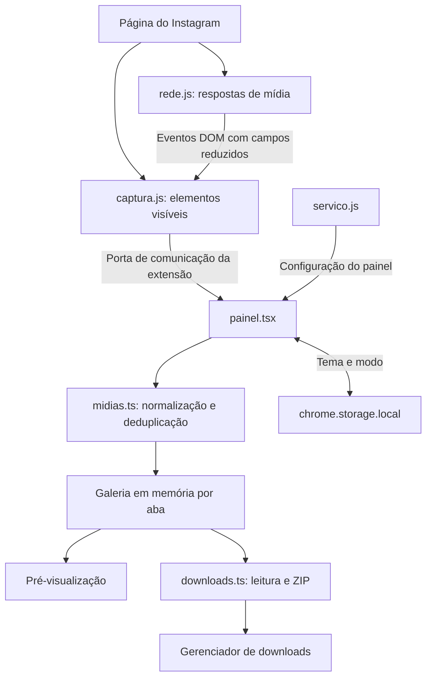

# Arquitetura técnica

[Voltar ao início](../README.md)

## Visão geral

Aplicação cliente baseada em Manifest V3, sem backend próprio. A interface é compilada pelo Vite; os scripts de página são distribuídos como JavaScript nativo. O service worker configura a abertura do painel lateral, enquanto a captura, a galeria e a preparação dos downloads são responsabilidades distintas.

## Estrutura do repositório

| Caminho | Responsabilidade |
| --- | --- |
| `public/manifest.json` | Identidade, permissões, política de conteúdo, scripts e painel. |
| `public/servico.js` | Configuração do painel na instalação e inicialização do navegador. |
| `public/rede.js` | Observação das respostas de rede da página e extração de mídias. |
| `public/captura.js` | Observação de elementos visíveis, validação e comunicação com o painel. |
| `src/principal.tsx` | Inicialização da aplicação React. |
| `src/painel.tsx` | Estado da galeria, filtros, seleção, configuração, conexão e prévia. |
| `src/midias.ts` | Normalização, identidade, deduplicação, formatos e nomes. |
| `src/downloads.ts` | Obtenção, leitura limitada, ZIP e encaminhamento dos arquivos. |
| `src/tipos.ts` | Contratos TypeScript de mídias, filtros e temas. |
| `src/estilos.css` | Estilos, temas, responsividade e acessibilidade visual. |
| `src/*.test.ts` | Testes unitários da lógica TypeScript. |
| `testes/rede.test.mjs` | Testes simulados do observador de rede. |
| `vite.config.ts`, `vitest.config.ts` | Configurações de compilação e testes. |
| `.github/workflows/verificacao.yml` | Integração contínua e artefato de compilação. |

## Ciclo da captura

1. O manifesto injeta o observador de rede no contexto principal da página em `document_start` e o script de captura no contexto isolado em `document_idle`.
2. O painel identifica a aba ativa da janela e abre uma porta chamada `ims-painel` no frame principal do Instagram.
3. O script de captura verifica o identificador da extensão, confirma a conexão com a ação `pronto` e ativa os observadores quando a primeira porta é conectada.
4. Elementos de imagem e vídeo visíveis são inspecionados; mutações, rolagem e eventos de carregamento agendam novas leituras.
5. Respostas elegíveis de rede já realizadas pela página são observadas sem disparar consultas adicionais. Os dados reduzidos seguem para o script isolado, que valida e encaminha somente campos de mídia.
6. O painel normaliza e reúne as mídias na memória correspondente à aba.
7. Na desconexão da última porta, os observadores de DOM são removidos e a extração de rede é desativada. Os wrappers de rede continuam instalados na página até seu descarregamento.

A identificação é heurística: elementos visíveis e respostas estruturadas podem fornecer candidatos diferentes. Não há uma API pública contratada para essa captura nem garantia de cobertura integral.

## Contrato de mídia

| Campo | Tipo | Finalidade |
| --- | --- | --- |
| `id` | string | Identificador calculado após normalização. |
| `url` | string | Endereço HTTPS da mídia. |
| `miniatura` | string | Endereço HTTPS da miniatura ou valor vazio. |
| `tipo` | imagem / video | Natureza da mídia. |
| `origem` | Stories / Destaques / Posts / Reels | Categoria estimada. |
| `largura` | number | Largura disponível, zero quando desconhecida. |
| `altura` | number | Altura disponível, zero quando desconhecida. |

O identificador utiliza tipo e caminho do arquivo, ou um nome de arquivo reconhecido por padrão. Parâmetros de consulta não compõem a identidade, mas são mantidos na URL de acesso. A maior área em pixels informada é priorizada; em caso de empate, a entrada mais recente pode substituir a anterior. Miniaturas identificadas como pertencentes a vídeos são removidas da lista de imagens independentes. Esses critérios podem produzir falsos agrupamentos ou duplicatas residuais.

## Comunicação e estado

| Canal | Mensagem | Direção |
| --- | --- | --- |
| Porta `ims-painel` | `acao: pronto` | Captura para painel. |
| Porta `ims-painel` | `midias: [...]` | Captura para painel. |
| Porta `ims-painel` | `acao: atualizar` | Painel para captura. |
| Eventos DOM | Controle e candidatos reduzidos | Entre os contextos da página e do script isolado. |

O painel mantém as galerias em um mapa por identificador de aba, a seleção da aba atual e as preferências de interface. A conexão possui prazo de confirmação de quatro segundos. A troca de aba reinicia seleção e prévia e cancela uma preparação de download ativa. Somente `tema` e `modo` são persistidos em `chrome.storage.local`.

Eventos DOM são uma fronteira não confiável: podem ser emitidos pela própria página. O projeto aplica validação dos campos recebidos, mas a origem desses eventos não é autenticada criptograficamente.

## Limites de processamento

| Limite | Implementação |
| --- | --- |
| Galeria | Até 1.000 mídias por aba. |
| Mensagem/lote de candidatos | Até 150 mídias. |
| Cache de emissão | Até 2.500 chaves no script de captura. |
| Corpo de resposta fetch observado | Até 5.000.000 bytes na leitura incremental. |
| Texto JSON processado | Até 5.000.000 caracteres. |
| Percurso de objetos | Até 20.000 iterações; arrays são percorridos com limite de 2.000 itens por array. |
| Eventos DOM de mídia | Até 500.000 caracteres. |
| URL normalizada pelo painel | Até 8.192 caracteres. |
| Dimensões normalizadas | Até 16.384 pixels por eixo. |
| Intervalo de coleta agendada | Aproximadamente 100 a 250 ms, conforme última coleta. |
| Download | 250 MiB de conteúdo por operação; prazo de 60 segundos por obtenção. |

Os limites não representam um teto global de memória. Respostas XHR já materializadas pelo navegador, elementos DOM, miniaturas e montagem do ZIP podem consumir recursos adicionais.

## Fluxo de download

O módulo valida a URL, solicita o conteúdo sem credenciais, rejeita redirecionamentos e confere o tipo MIME. A leitura incremental limita os bytes acumulados e aceita cancelamento. Um arquivo é encaminhado individualmente; vários arquivos são reunidos em ZIP sem recompressão. O navegador recebe uma URL de objeto e o módulo tenta revogá-la após conclusão/interrupção ou ao final do prazo de limpeza de 15 minutos.

O tipo MIME é uma validação declarativa, não uma inspeção de assinatura binária ou verificação antimalware. A confirmação da solicitação ao navegador não equivale à conclusão do download.

## Decisões e pontos de evolução

- Manter processamento local reduz dependências operacionais e evita necessidade de cadastro em um serviço próprio.
- Manifest V3 integra a extensão ao navegador e limita as permissões declaradas.
- Separar lógica de mídia da interface permite testes unitários sem acesso a contas reais.
- A dependência de estruturas internas do Instagram exige homologação contínua.
- A reprodução de vídeos segmentados, cobertura de múltiplos formatos de resposta, isolamento de eventos DOM e testes ponta a ponta são áreas que ainda exigem avaliação.

Veja [privacidade e segurança](privacidade-e-seguranca.md) e [testes e homologação](testes-e-homologacao.md).

## Evolução na versão 0.3.0

O módulo `public/contexto.js` identifica o contexto pela rota. A navegação entre Stories do mesmo perfil preserva a galeria; mudanças de contexto reiniciam seu estado. Respostas estruturadas são filtradas por usuário, código de publicação ou identificador de destaque, com herança de contexto para carrosséis e conjuntos de Stories. A emissão ocorre em lotes de até 100 candidatos; o percurso tem limite de 50.000 iterações e até 5.000 itens por array. A galeria mantém até 10.000 mídias por aba. A limpeza envia os identificadores ao script de captura, invalida respostas anteriores e recebe confirmação. Os demais limites de tamanho de resposta e download permanecem. A identificação depende da estrutura disponibilizada pela página e precisa de homologação real.
